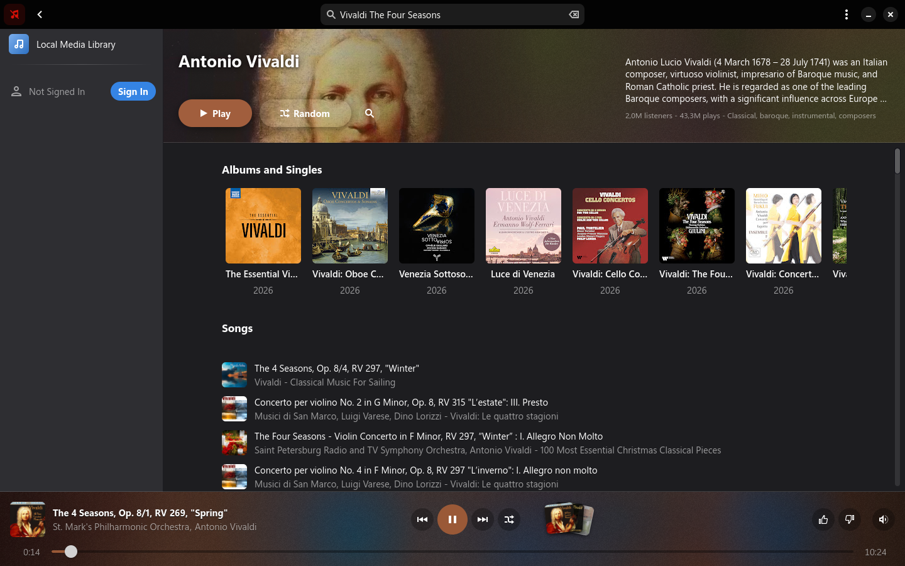

  

<h1 align="center">Crimson Music</h1>

A native <a href="https://gnome.pages.gitlab.gnome.org/libadwaita/">libadwaita</a> music player for <a href="https://music.youtube.com">YouTube Music</a> on Linux.

  
  
  

  <a href="https://github.com/Crimson-Org/crimson-music/releases/latest"><b>Download Here!</b></a>

  

## Why

Crimson Music plays YouTube Music in a native desktop app, with your account, playlists and liked songs.\
Recommendations stay on the Home page.

## About

### Your library

Your liked songs and playlists, with their covers.

### Search

Search your library and YouTube Music as you type, with your own playlists first.\
Artist and album pages show all their releases.

### Playlists

Create, rename and delete playlists, and drag songs and playlists to reorder them.

### Playing

Play playlists in order or shuffled, while the player bar takes on the colours of the cover.

### Dynamic playlists

Dynamic playlists pick songs from your liked and local music by genre, mood, tempo, year and your own tags, and update by themselves.

### Lyrics and comments

Read the lyrics and comments of the playing song, and jump between a video's chapters.

### No account needed

Search and play without signing in, and sign in to add your playlists and liked songs.

### Your own music

The Local Media Library plays music from your Music folder, and Settings lets you pick other folders.

### Fewer ads

Ads are removed, and Google's ad and tracking servers are blocked.

## Building

You need a [C compiler](https://gcc.gnu.org/), [make](https://www.gnu.org/software/make/), [pkg-config](https://www.freedesktop.org/wiki/Software/pkg-config/) and the development files for [GTK4](https://gtk.org), [libadwaita](https://gnome.pages.gitlab.gnome.org/libadwaita/), [WebKitGTK](https://webkitgtk.org), [libsoup](https://libsoup.gnome.org), [SQLite](https://sqlite.org) and [GStreamer](https://gstreamer.freedesktop.org).\
On [openSUSE](https://www.opensuse.org/) these come from `sudo zypper install gcc make pkg-config gtk4-devel libadwaita-devel webkitgtk4-devel libsoup-devel sqlite3-devel gstreamer-devel gstreamer-plugins-base-devel`.

Steps:
 1. Clone using `git clone --recurse-submodules https://github.com/Crimson-Org/crimson-music`
 2. Run `sh .crimson-build/install.sh`

`sh .crimson-build/uninstall.sh` uninstalls Crimson Music.
